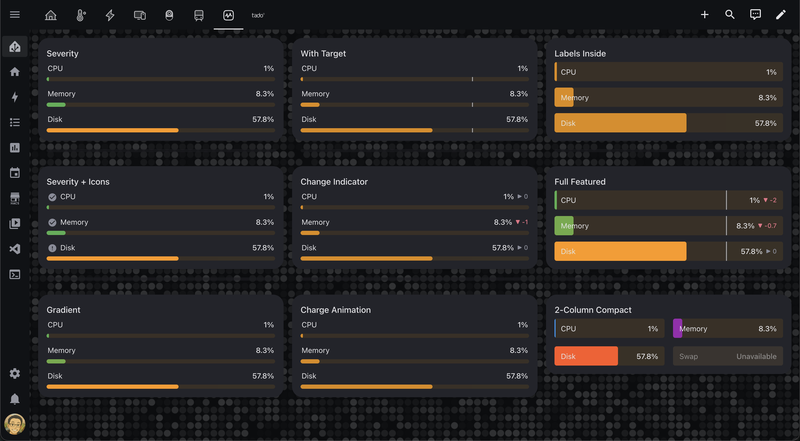
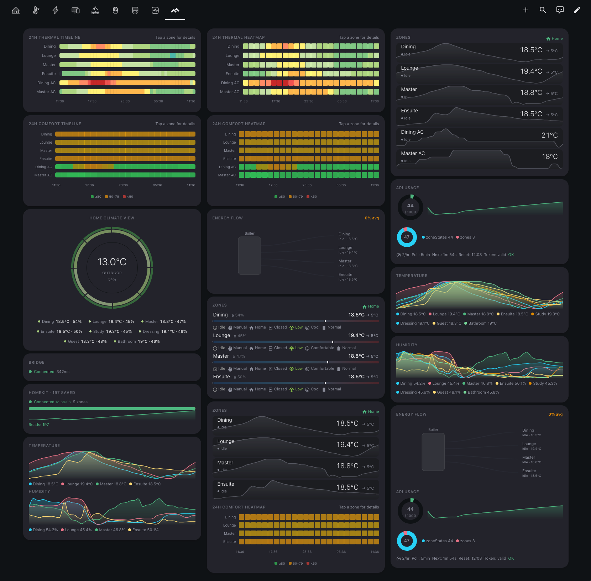
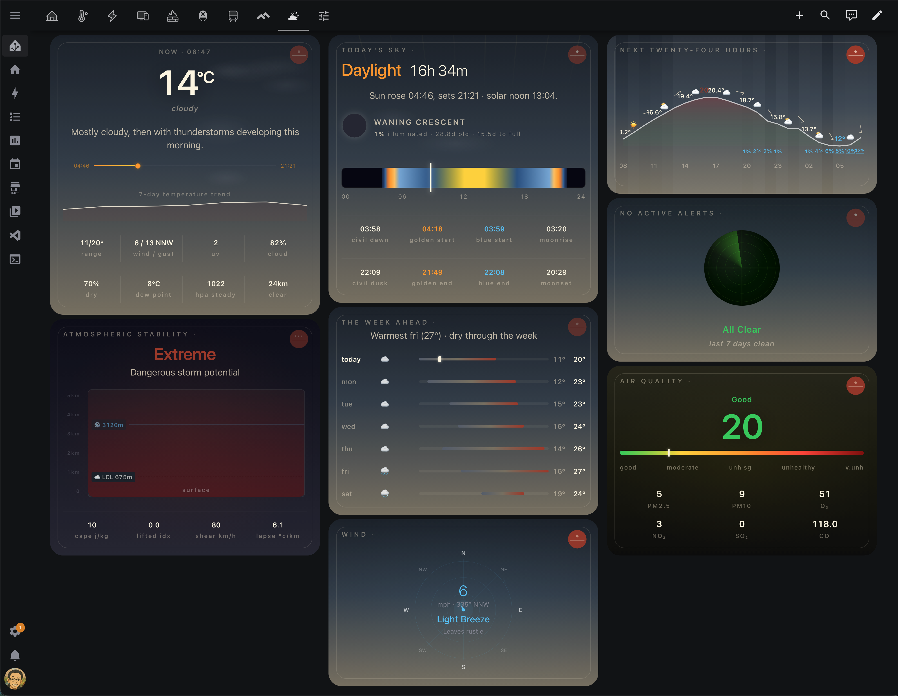

<div align="center">

<picture>
  <source media="(prefers-color-scheme: dark)" srcset="brand/dark_logo@2x.png" />
  
</picture>

<br />

<em>Data at a glance. Climate at your fingertips.</em>

   

   [](https://buymeacoffee.com/hiallfyi)

**Pulse Card puts three Home Assistant dashboard cards in one install: a compact bar chart, a climate dashboard for every heating and cooling zone, and a weather card with atmospheric effects.**

[Quick Start](#quick-start) • [Cards](#the-three-cards) • [Known limitations](#known-limitations) • [FAQ](#faq) • [Discussions](https://github.com/hiall-fyi/pulse-card/discussions)

</div>

---

## About

Pulse Card is a set of custom Lovelace cards for Home Assistant, installed once through HACS. The three cards share one set of design tokens and one resource entry. It is developed independently of Home Assistant and Nabu Casa. Tado CE and Atmos CE, which some sections can use, are separate integrations by the same author, and the cards work without either.

---

## Why use Pulse Card

Three situations where it is worth a look:

1. **You miss bar-card.** The Pulse Bar Card is a modern replacement for the discontinued bar-card. Any numeric sensor becomes a clean bar with severity colours, a sparkline, a target marker or a slider, and many bar-card configs move across by changing the card type.
   [Learn more: Bar Card Guide →](BAR_CARD_GUIDE.md)
2. **You have several heating or cooling zones and want one card for all of them.** The Pulse Climate Card works with any `climate.*` entity. It shows every zone at once, then adds history strips, a radial thermal view, a home summary and an energy flow when you ask for them. If you run Tado CE, its sensors are found automatically and unlock eight more sections.
   [Learn more: Climate Card Guide →](CLIMATE_CARD_GUIDE.md)
3. **You want weather that looks like weather.** The Pulse Weather Card works with any `weather.*` entity, with rain, snow, cloud and lightning effects, a seven-day forecast, a meteogram, a wind compass and an astronomy ribbon. Pair it with Atmos CE for air quality, alerts and atmospheric stability.
   [Learn more: Weather Card Guide →](WEATHER_CARD_GUIDE.md)

If the built-in cards already do what you need, keep them. Pulse Card is for when you want more on the screen than they give you.

---

## The three cards

### Pulse Card

A compact horizontal bar chart for any numeric sensor.



**Highlights:** severity colours · sparkline trends · slider mode · target marker · trend indicator · multi-column grid · conditional visibility · tap, hold and double-tap actions · bar-card compatible with a few exceptions

[Full configuration guide →](BAR_CARD_GUIDE.md)

### Pulse Climate Card

A climate dashboard for one zone or a whole house. It works with any `climate.*` entity, and picks up Tado CE sensors automatically for an enriched display.



**Highlights:** multi-zone overview · temperature, humidity and power bars · sparkline modes · radial thermal view · thermal and comfort strips · home status · zone ranking · energy flow and AC flow · frosted glass panels

[Full configuration guide →](CLIMATE_CARD_GUIDE.md)

### Pulse Weather Card

A weather card with atmospheric effects, astronomy and air quality. It works with any `weather.*` entity, and pairs with the [Atmos CE](https://github.com/hiall-fyi/atmos_ce) integration for atmospheric stability, weather alerts and an extended forecast.



**Highlights:** overview hero · seven-day forecast · meteogram · wind compass rose · astronomy ribbon · air quality gauge · weather alerts radar · atmospheric stability column

[Full configuration guide →](WEATHER_CARD_GUIDE.md)

---

## What each card needs

| Card | Needs | Optional |
| --- | --- | --- |
| Pulse Card (`custom:pulse-bar-card`) | One numeric entity, such as a sensor | Everything else: sparkline and trend indicator need the Home Assistant recorder |
| Pulse Climate Card (`custom:pulse-climate-card`) | A `climate.*` entity (a `water_heater.*` also works) | A power reading, an outdoor temperature, history sensors, Tado CE sensors |
| Pulse Weather Card (`custom:pulse-weather-card`) | Nothing: the first `weather.*` entity is used if you name none | `sun.sun` for the astronomy ribbon, Atmos CE sensors for air quality, alerts and atmosphere |

The old element name `custom:pulse-card` still works for the Bar Card. It is an alias that will be removed in v2.0.0, so use `custom:pulse-bar-card` in new configs. Home Assistant 2024.1 or newer is required.

---

## Quick start

### Install with HACS (recommended)

[](https://my.home-assistant.io/redirect/hacs_repository/?owner=hiall-fyi&repository=pulse-card&category=plugin)

1. Click the button above, or search for **Pulse Card** in HACS under **Frontend**.
2. Click **Download**.
3. Restart Home Assistant.

All three cards are bundled in `pulse-card.js`, so one resource entry covers them. The visual editors are separate files that load next to it only when you open a card's editor.

<details>
<summary>Manual installation</summary>

1. Download `pulse-card.js`, `pulse-card-editor.js`, `pulse-climate-editor.js` and `pulse-weather-card-editor.js` from the [latest release](https://github.com/hiall-fyi/pulse-card/releases).
2. Copy all four files to `config/www/`.
3. Add a resource in **Settings → Dashboards → Resources**:
   - URL: `/local/pulse-card.js`
   - Type: JavaScript Module

</details>

### Add a card

Pick **Pulse Card**, **Pulse Climate Card** or **Pulse Weather Card** from the card picker, or paste YAML.

**Pulse Card**

```yaml
type: custom:pulse-bar-card
entity: sensor.battery_level
```

```yaml
type: custom:pulse-bar-card
title: Room Sensors
entities:
  - sensor.temperature
  - entity: sensor.humidity
    name: Humidity
    color: "#2196F3"
```

**Pulse Climate Card**

```yaml
type: custom:pulse-climate-card
entity: climate.living_room
```

```yaml
type: custom:pulse-climate-card
zones:
  - entity: climate.living_room
  - entity: climate.bedroom
  - entity: climate.kitchen
sections:
  - zones
  - graph
  - radial
```

**Pulse Weather Card**

```yaml
type: custom:pulse-weather-card
weather_entity: weather.home
sections:
  - type: overview
  - type: forecast
  - type: meteogram
  - type: wind
  - type: astro
```

---

## Features

### Pulse Climate Card sections

| Section | Shows | Needs |
| --- | --- | --- |
| `zones` | Zone rows with temperature, humidity, power and chips (the default) | A climate entity |
| `graph` | Multi-line history chart of temperature or humidity per zone | A sensor with history |
| `thermal_strip` | Colour-coded temperature or humidity strip per zone, as a timeline or a heatmap | A sensor with history |
| `comfort_strip` | Comfort score heatmap by time slot | A sensor with history |
| `timeline_group` | A tabbed 24-hour Thermal and State view | A sensor with history |
| `home_status` | Whole-home summary with a sorted zone list and deviation bars | A climate entity |
| `zone_ranking` | Leaderboard with Power, Temp, Humidity and Comfort tabs | A climate entity |
| `radial` | Circular thermal compass, with the outdoor temperature in the centre | A climate entity, optionally an outdoor temperature |
| `energy_flow` | Animated flow from the boiler to each zone | A heating power reading |
| `energy_flow_ac` | The same idea for air conditioners, with the air flowing down to each zone | A climate entity (a power sensor is optional) |
| `donut` | Ring chart | Your own `segments` |
| `api`, `bridge`, `homekit`, `weather`, `environment`, `thermal`, `schedule`, `system_health_group` | Tado CE views: API usage, bridge and HomeKit status, outdoor weather, mould and condensation risk, heating rate, schedule | Tado CE sensors |

Zones also have tap, hold and double-tap actions and chip actions.

### Pulse Weather Card sections

| Section | Shows | Needs |
| --- | --- | --- |
| `overview` | Hero with the current weather and a day and night arc | A weather entity |
| `forecast` | Seven-day forecast | A weather entity |
| `meteogram` | Hourly chart in the style of yr.no | A weather entity |
| `wind` | Compass rose with gusts | A weather entity |
| `astro` | Sunrise, sunset and moon ribbon | `sun.sun` |
| `air_quality` | Air quality gauge | Atmos CE |
| `alerts` | Weather alerts radar | Atmos CE |
| `atmosphere` | Atmospheric stability column | Atmos CE |

---

## Configuration

Every card has a visual editor, which opens from the card picker or from the card's edit button. The editor does not cover everything: per-entity severity ranges and conditional visibility on the Bar Card, and per-zone chip filters and some section options on the Climate Card, are YAML-only. The guides list every option.

| Card | Guide | What is covered |
| --- | --- | --- |
| Pulse Bar Card | [BAR_CARD_GUIDE.md](BAR_CARD_GUIDE.md) | Configuration reference, style presets, bar-card migration, CSS custom properties |
| Pulse Climate Card | [CLIMATE_CARD_GUIDE.md](CLIMATE_CARD_GUIDE.md) | Zone setup, every section, sparkline modes, Tado CE auto-discovery, actions |
| Pulse Weather Card | [WEATHER_CARD_GUIDE.md](WEATHER_CARD_GUIDE.md) | Section types, Atmos CE auto-discovery, brand-mark toggles, CSS custom properties |

---

## Known limitations

These are how the cards work today, not bugs. Check here before opening a report.

| Limitation | Detail |
| --- | --- |
| History charts need a sensor | The graph, strips and sparklines read the history of a temperature or humidity sensor. A climate entity does not store that history the same way. Tado CE's sensors are picked up automatically; for anything else set `temperature_entity` and `humidity_entity` to your sensors. |
| The Bar Card's sparkline and trend indicator need the recorder | Without the Home Assistant recorder there is no history to draw. |
| An air conditioner with no `hvac_action` is an estimate | The card reads a power sensor first if there is one, then the mode and the target. For an infrared unit "Heating" means it is in heat mode and below target, because the card cannot know whether the compressor is running. |
| Frost protection applies to zones with found sensors | A zone the card has found sensors for, which is what Tado CE provides, reads Off when it is set to heat at its minimum temperature and is not heating. Other thermostats at their own minimum show their normal reading. |
| The Energy Flow needs a heating power reading | Without one it says "No heating data". The AC flow does not need a power sensor. |
| "On target" has two sizes | Home Status counts a zone as on target within 1 degree (1.8°F). The "At target" tag in the Zones section is stricter, within 0.3 degrees. |
| Long zone names can overflow the Energy Flow | Give the zone a short `name:`. |
| The Climate Card's strips, heatmap, radial and Energy Flow are pointer-only for drill-down | The same room data is reachable through the zone rows. |
| The Weather Card stays dark in a light theme | Its sections paint their own dark backdrop by design. |
| The Weather Card refreshes the forecast every 30 minutes | There is no push subscription, and the extended Atmos CE forecast is hourly only. |
| The Weather Card's moon phase is approximate | Without Atmos CE the moon row is a plain disc. |
| bar-card keys that are not supported | `width`, `saturation`, `hue` and `entity_config`. The bar height, the name and value position and the icon default also differ; the Bar Card Guide has the full migration list. |
| Frosted glass needs a modern browser | An older browser falls back to a solid background. |

---

## FAQ

<details>
<summary><strong>Do I need Tado CE for the Climate Card?</strong></summary>

No. The Climate Card works with any `climate.*` entity. If Tado CE is installed, the card finds its sensors on its own and adds eight more sections plus Tado chips such as mould, condensation, open window and battery.

</details>

<details>
<summary><strong>Do I need Atmos CE for the Weather Card?</strong></summary>

No. The overview, forecast, meteogram and wind sections work on a plain `weather.*` entity, and the astronomy ribbon also needs `sun.sun`. The air quality, alerts and atmosphere sections need Atmos CE. If fewer than three Atmos CE sensors match your weather entity, the card assumes it is not installed; set `atmos_source` if your sensors use a different name.

</details>

<details>
<summary><strong>Can I move from bar-card?</strong></summary>

Mostly yes. Change `type: custom:bar-card` to `type: custom:pulse-bar-card` and check the result. The default bar is thinner (8 px against 40 px), the name and value sit outside the bar, and `rounding` is now `border_radius`. The keys `width`, `saturation`, `hue` and `entity_config` are not supported. The [Bar Card Guide](BAR_CARD_GUIDE.md) has the full list.

</details>

<details>
<summary><strong>Do temperatures follow my Fahrenheit setting?</strong></summary>

Yes. The cards use the unit your Home Assistant is set to, and the colour bands, gauge ranges and the at-target, shortfall and comfort thresholds follow the same scale, so 68°F is coloured and judged like 20°C.

</details>

<details>
<summary><strong>Why does my air conditioner say Idle or Heating?</strong></summary>

If the climate entity reports no `hvac_action`, the card estimates it. A power sensor above zero decides first, then the mode and the target: heat below target is Heating, cool above target is Cooling, dry is Drying and fan only is Fan. An infrared unit gives no feedback, so the card cannot tell whether the compressor is actually cycling.

</details>

<details>
<summary><strong>Why is my chart empty or showing "No data"?</strong></summary>

The charts read the history of a sensor, not of the climate entity. Point `temperature_entity` and `humidity_entity` at your own sensors, or install Tado CE and let the card find them. Live temperature, target and humidity still come from the climate entity itself.

</details>

<details>
<summary><strong>I updated and the card looks the same.</strong></summary>

The browser keeps the old card file. Do a hard refresh (Ctrl+Shift+R, or Cmd+Shift+R on a Mac), and restart Home Assistant if you updated through HACS and it still has not changed.

</details>

---

## Uninstall

1. In HACS, open Pulse Card and choose **⋮ → Remove**.
2. If you installed by hand, or the resource entry is still listed under **Settings → Dashboards → Resources**, delete the `/local/pulse-card.js` entry and the files in `config/www/`.
3. Restart Home Assistant.

Dashboards that still use `custom:pulse-bar-card`, `custom:pulse-climate-card` or `custom:pulse-weather-card` will show a "custom element doesn't exist" error until you remove those cards.

---

## Accessibility

Rows, chips and tab strips can be reached with the keyboard: Tab moves between them, Enter or Space activates whatever has focus, and the focus ring follows your Home Assistant accent colour. Bar rows you can drag also respond to the arrow keys.

If your system is set to reduce motion, the Weather Card skips its rain, snow, cloud and lightning effects entirely rather than freezing them mid-frame. The air-quality smog overlay is the exception, since its tint carries the pollution reading, so that stays and only the drifting dust and haze blobs are dropped.

Two gaps worth knowing about. The Climate Card's timeline, heatmap, radial and Energy Flow views are pointer-only for drill-down, though the same room data is reachable through the zone rows. And the Weather Card's sections paint their own dark backdrop by design, so they stay dark in a light Home Assistant theme.

---

## Documentation

| Document | Purpose |
| --- | --- |
| [BAR_CARD_GUIDE.md](BAR_CARD_GUIDE.md) | Pulse Card configuration, presets and bar-card migration |
| [CLIMATE_CARD_GUIDE.md](CLIMATE_CARD_GUIDE.md) | Pulse Climate Card setup, sections and Tado CE auto-discovery |
| [WEATHER_CARD_GUIDE.md](WEATHER_CARD_GUIDE.md) | Pulse Weather Card sections and Atmos CE auto-discovery |
| [ROADMAP.md](ROADMAP.md) | Planned work |
| [CREDITS.md](CREDITS.md) | Contributor credits per release |
| [CHANGELOG.md](CHANGELOG.md) | Version history |
| [SECURITY.md](SECURITY.md) | Supported versions and how to report a vulnerability |

---

## Development

```bash
npm install
npm run build      # Build pulse-card.js (all three cards) and the three editors
npm run dev        # Watch mode for the Bar Card entry
npm test           # Run tests
npm run lint       # Lint source
npm run typecheck  # JSDoc type checking via tsc
```

See [CONTRIBUTING.md](CONTRIBUTING.md) for the full guidelines.

---

## Contributing

The cards are shaped by what people report. A bug report with your card config and Home Assistant version, or a feature idea with the setup behind it, is the most useful thing you can send. [Open a bug report](https://github.com/hiall-fyi/pulse-card/issues/new/choose), or float an idea in [Discussions](https://github.com/hiall-fyi/pulse-card/discussions) before any code.

Code contributions are welcome too: fork, branch, commit and open a pull request.

---

## License

Released under the **GNU Affero General Public License v3.0 (AGPL-3.0)**. Modifications must be released as open source under the same licence with attribution. See [LICENSE](LICENSE) for the full text.

**Author:** Joe Yiu ([@hiall-fyi](https://github.com/hiall-fyi))

---

<details>
<summary><strong>Disclaimer</strong></summary>

This project is not affiliated with, endorsed by, or connected to Home Assistant, Nabu Casa or tado GmbH. *tado* is a registered trademark of tado GmbH and *Home Assistant* is a trademark of Nabu Casa, Inc. Tado CE and Atmos CE are separate integrations by the same author, and the cards work without either. The cards are provided "as is" without warranty. Use at your own risk.

</details>
